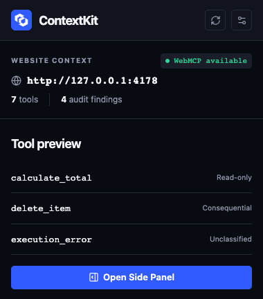
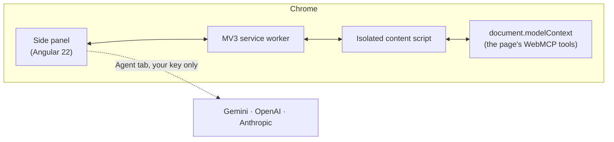

<p align="center">
  
</p>

<h1 align="center">ContextKit</h1>

<p align="center">
  <b>DevTools for WebMCP.</b><br/>
  See every tool a website hands to AI agents, run them by hand, audit them, or let Gemini, ChatGPT or Claude drive them, all from Chrome's side panel.
</p>

<p align="center">
  <a href="https://github.com/hkolos1/contextkit/releases/latest"></a>
  <a href="https://github.com/hkolos1/contextkit/actions/workflows/ci.yml"></a>
  <a href="LICENSE"></a>
  
</p>

<p align="center">
  <a href="https://github.com/hkolos1/contextkit/releases/latest"></a>
  <a href="#install"></a>
</p>

<p align="center">
  
  &nbsp;
  
</p>

## Why

Websites are starting to register **WebMCP tools**: typed functions that AI agents call instead of clicking through the DOM. Great for agents, but invisible to you. Which tools does this page expose? Are the schemas any good? Is `delete_account` marked as destructive? What happens when you actually call it?

ContextKit answers that in one click.

- 🔎 **See everything.** Every registered tool with its schema, annotations and safety hints, searchable and exportable.
- 🧪 **Poke at it.** Generated forms or raw JSON, validation before you run, results and timings after. State-changing calls ask first.
- 🤖 **Let an agent loose (on a leash).** Type a task, pick Gemini, ChatGPT or Claude, bring your own key. Read-only calls run, everything else waits for your thumbs up.
- 🛡️ **Audit it.** Spec issues, authoring tips and heuristics, exported as JSON or a standalone HTML report.
- 🔒 **Stays on your machine.** No account, no backend, no telemetry, no host permissions. Without an API key it makes zero network requests.

## How it works



Access is granted per tab with `activeTab` when you click the extension, so ContextKit never reads a site you did not open it on.

## Built with

<picture>
  <source media="(prefers-color-scheme: dark)" srcset="https://skillicons.dev/icons?i=angular%2Cts%2Ctailwind%2Cnodejs%2Cvitest&theme=dark">
  
</picture>

Angular 22 standalone components in a Manifest V3 extension, Tailwind CSS 4, esbuild, Vitest for unit tests, Playwright driving real Chrome for Testing for end-to-end tests, Biome for linting, and the official Anthropic SDK for Claude. Every release ZIP is built from an allowlist and tested in the browser before it is published.

## Install

1. Download the latest **contextkit-v…zip** extension asset from [GitHub Releases](https://github.com/hkolos1/contextkit/releases/latest).
2. Extract the ZIP to a directory you can keep.
3. Open `chrome://extensions` in desktop Chrome.
4. Enable **Developer mode**.
5. Click **Load unpacked**.
6. Select the extracted directory containing `manifest.json`.
7. For local WebMCP testing, enable **WebMCP for testing** at `chrome://flags/#enable-webmcp-testing` and relaunch Chrome.

Visit a WebMCP-enabled HTTPS or localhost page. Click **ContextKit** in Chrome's extensions menu to grant access to that tab, then **Open Side Panel**. To update, replace the contents of the extracted directory with the next release and click **Reload** at `chrome://extensions`.

## Workspace

| View | What you can do |
| --- | --- |
| Tools | Search the inventory, filter safety hints, inspect schemas and annotations, and copy, export or import definitions. |
| Playground | Edit nested arguments with generated forms or raw JSON, validate them, run a tool, and inspect its result and duration. Consequential, destructive and unclassified actions require confirmation. |
| Agent | Describe a task in plain language. The model picks and calls the page's tools; read-only calls run directly, other calls wait for your approval (consequential and destructive ones always). Choose Gemini (default), ChatGPT or Claude and add that provider's API key in the tab's settings; a Gemini key from Google AI Studio works on its free tier. |
| Activity | Review observed inventory changes and calls initiated by ContextKit. Filter, clear or export the journal. |
| Audit | Review specification issues, authoring recommendations and heuristics. Save a JSON report or standalone HTML report. |

The screenshots above show the built extension inspecting the included native WebMCP demo.

## Browser requirements and limits

- **Desktop Chrome.** Chrome 116 introduced the user-gesture side-panel action. Live discovery additionally needs a secure context and Chrome’s experimental WebMCP API in the isolated content script. Release checks passed with Chrome for Testing **158.0.8127.88** (Stable on November 24, 2026) and **159.0.8154.6**. The site origin trial began in Chrome 149. For local development, use the flag in step 7. [Chrome WebMCP guide](https://developer.chrome.com/docs/ai/webmcp) · [Side Panel API](https://developer.chrome.com/docs/extensions/reference/api/sidePanel)
- **Document scope.** The adapter uses native `document.modelContext.getTools()` and `executeTool()` for the active top-level document. Registration style may be unavailable. Cross-frame tools, results after navigation and other agents’ execution histories are outside the inspector's scope. [WebMCP specification](https://webmachinelearning.github.io/webmcp/)
- **Offline use.** Import an inventory when native discovery is unavailable. Forms support common object, array and scalar schemas. Unsupported keywords such as references, patterns and composition block execution. Safety hints come from the website. Audit heuristics identify metadata for human review.
- **Bounds.** Imports accept up to 150 tools and 1 MB on disk, subject to depth and complexity limits. Arguments and results are capped at 48,000 serialized characters. An invocation timeout ends local waiting after 25 seconds (five minutes for Agent calls). Check the site before retrying a state-changing tool.

## Privacy and security

The extension pages may connect only to the Gemini, OpenAI and Anthropic APIs (Content Security Policy), which the Agent tab uses after you add a key for that provider. The manifest requests `activeTab` and `scripting` for on-demand inspection, `sidePanel` for the workspace, and `storage` for preferences and history. It declares no host permissions. History stays in session memory by default. Settings can persist it on this device. Exported files may include sensitive arguments and results. [Privacy](PRIVACY.md) · [Security](SECURITY.md)

## Development

Use Node 24.15+ in the 24.x series and npm.

```sh
npm ci
npm run build
npm run demo
```

Load `dist/` as an unpacked extension and visit [the local inventory demo](http://127.0.0.1:4178). Try `get_item_details` with `{"id":"A1"}`. Stop the demo server before running the integration suite, which starts its own instance.

```sh
npm run lint
npm run typecheck
npm test
npm run package
npx playwright install chromium
npm run e2e
```

Angular components live in `src/ui/`. The MV3 worker, isolated adapter and execution boundary live in `src/extension/`. Shared validation, messaging and audit rules live in `src/core/`. The packaging command builds a clean extension and writes the versioned ZIP to `release/`.

[Contributing](CONTRIBUTING.md) · [Changelog](CHANGELOG.md) · [MIT license](LICENSE)
