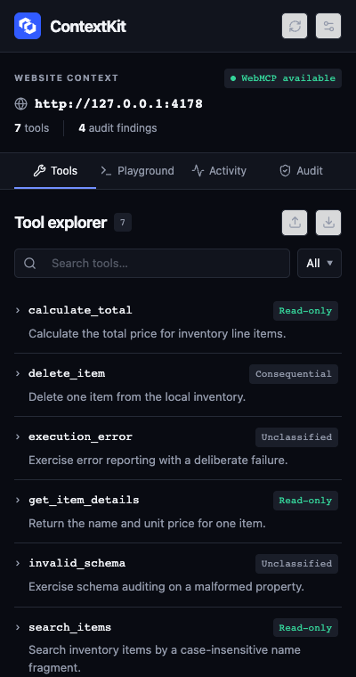

# ContextKit

Inspect, test and audit the WebMCP tools a website exposes, directly from a Chrome side panel. ContextKit runs locally and requires no account or API key.

[](https://github.com/hkolos1/contextkit/releases/latest)
[](https://github.com/hkolos1/contextkit/actions/workflows/ci.yml)
[](LICENSE)

**[Download the extension from GitHub Releases](https://github.com/hkolos1/contextkit/releases/latest)**

## Install

1. Download the latest **contextkit-v…zip** extension asset from [GitHub Releases](https://github.com/hkolos1/contextkit/releases/latest).
2. Extract the ZIP to a directory you can keep.
3. Open `chrome://extensions` in desktop Chrome.
4. Enable **Developer mode**.
5. Click **Load unpacked**.
6. Select the extracted directory containing `manifest.json`.
7. For local WebMCP testing, enable **WebMCP for testing** at `chrome://flags/#enable-webmcp-testing` and relaunch Chrome.

Visit a WebMCP-enabled HTTPS or localhost page. Click **ContextKit** in Chrome's extensions menu to grant access to that tab, then **Open Side Panel**. To update, replace the contents of the extracted directory with the next release and click **Reload** at `chrome://extensions`.

## Workspace

| View | What you can do |
| --- | --- |
| Tools | Search the inventory, filter safety hints, inspect schemas and annotations, and copy, export or import definitions. |
| Playground | Edit nested arguments with generated forms or raw JSON, validate them, run a tool, and inspect its result and duration. Consequential, destructive and unclassified actions require confirmation. |
| Activity | Review observed inventory changes and calls initiated by ContextKit. Filter, clear or export the journal. |
| Audit | Review specification issues, authoring recommendations and heuristics. Save a JSON report or standalone HTML report. |

 

Both screenshots show the built extension inspecting the included native WebMCP demo.

## Browser requirements and limits

- **Desktop Chrome.** Chrome 116 introduced the user-gesture side-panel action. Live discovery additionally needs a secure context and Chrome’s experimental WebMCP API in the isolated content script. Release checks passed with Chrome for Testing **158.0.8127.88** (Stable on November 24, 2026) and **159.0.8154.6**. The site origin trial began in Chrome 149. For local development, use the flag in step 7. [Chrome WebMCP guide](https://developer.chrome.com/docs/ai/webmcp) · [Side Panel API](https://developer.chrome.com/docs/extensions/reference/api/sidePanel)
- **Document scope.** The adapter uses native `document.modelContext.getTools()` and `executeTool()` for the active top-level document. Registration style may be unavailable. Cross-frame tools, results after navigation and other agents’ execution histories are outside the inspector's scope. [WebMCP specification](https://webmachinelearning.github.io/webmcp/)
- **Offline use.** Import an inventory when native discovery is unavailable. Forms support common object, array and scalar schemas. Unsupported keywords such as references, patterns and composition block execution. Safety hints come from the website. Audit heuristics identify metadata for human review.
- **Bounds.** Imports accept up to 150 tools and 1 MB on disk, subject to depth and complexity limits. Arguments and results are capped at 48,000 serialized characters. An invocation timeout ends local waiting after 25 seconds. Check the site before retrying a state-changing tool.

## Privacy and security

The manifest requests `activeTab` and `scripting` for on-demand inspection, `sidePanel` for the workspace, and `storage` for preferences and history. It declares no host permissions. History stays in session memory by default. Settings can persist it on this device. Exported files may include sensitive arguments and results. [Privacy](PRIVACY.md) · [Security](SECURITY.md)

## Development

Use Node 24.15+ in the 24.x series and npm.

```sh
npm ci
npm run build
npm run demo
```

Load `dist/` as an unpacked extension and visit [the local inventory demo](http://127.0.0.1:4178). Try `get_item_details` with `{"id":"A1"}`. Stop the demo server before running the integration suite, which starts its own instance.

```sh
npm run lint
npm run typecheck
npm test
npm run package
npx playwright install chromium
npm run e2e
```

Angular components live in `src/ui/`. The MV3 worker, isolated adapter and execution boundary live in `src/extension/`. Shared validation, messaging and audit rules live in `src/core/`. The packaging command builds a clean extension and writes the versioned ZIP to `release/`.

[Contributing](CONTRIBUTING.md) · [Changelog](CHANGELOG.md) · [MIT license](LICENSE)
