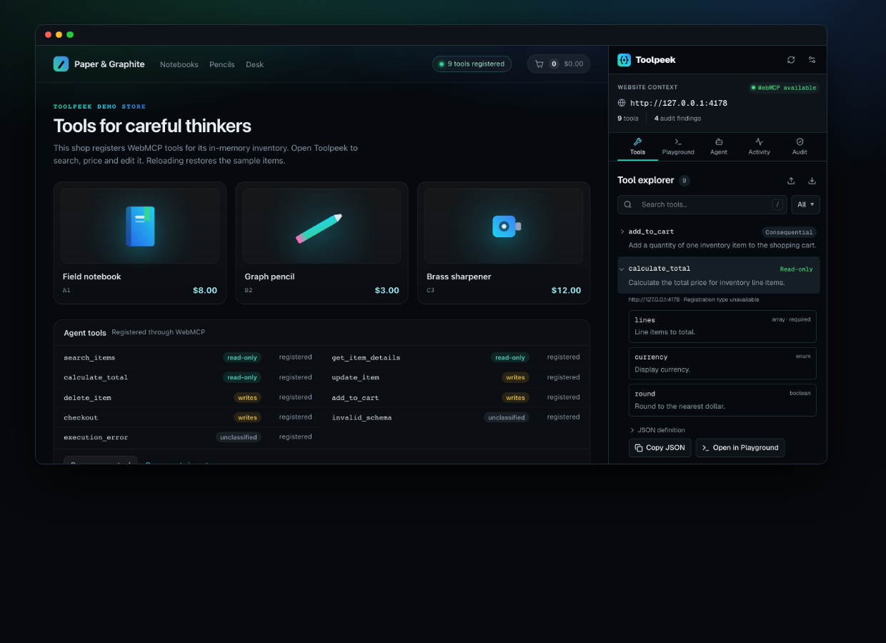

<p align="center">
  <picture>
    <source media="(prefers-color-scheme: dark)" srcset="brand/wordmark-dark.svg">
    
  </picture>
</p>

<p align="center">
  <b>See what AI agents see.</b><br>
  An open-source browser extension for discovering, inspecting, and interacting with WebMCP tools directly from your browser.
</p>

<p align="center">
  <a href="https://toolpeek.web.app">Website</a> ·
  <a href="https://github.com/hkolos1/toolpeek/releases/latest">Download</a> ·
  <a href="#install">Install</a> ·
  <a href="PRIVACY.md">Privacy</a>
</p>

<p align="center">
  <a href="https://github.com/hkolos1/toolpeek/releases/latest"></a>
  <a href="https://github.com/hkolos1/toolpeek/actions/workflows/ci.yml"></a>
  <a href="https://github.com/hkolos1/toolpeek/actions/workflows/website.yml"></a>
  <a href="LICENSE"></a>
</p>

<p align="center">
  
</p>

Websites can register **WebMCP tools**: typed functions that AI agents call instead of clicking through the page. Toolpeek shows you those tools and lets you work with them, all from Chrome's side panel.

## Features

| View | What you can do |
| --- | --- |
| **Tools** | See every tool the active page registers. Search, filter by safety hint (read-only, consequential, destructive), read parameters and the full JSON definition, and copy, export or import inventories. |
| **Playground** | Fill a generated form or raw JSON, validate it against the schema and run the tool. State-changing tools ask for confirmation. Responses show status, duration and JSON you can copy. |
| **Agent** | Describe a task and Gemini, ChatGPT or Claude calls the page's tools with your own API key. Read-only calls run directly; everything else waits for your approval. |
| **Activity** | A local journal of inventory changes and tool runs with arguments, responses and errors. Filter, clear or export it. |
| **Audit** | Specification issues, authoring recommendations and heuristics, exported as JSON or a standalone HTML report. |

Also: system, dark and light themes, `/` to search tools, <kbd>Ctrl</kbd>/<kbd>⌘</kbd>+<kbd>Enter</kbd> to run the selected tool.

## Install

**Chrome Web Store.** Not available yet; the listing is in preparation ([submission notes](CHROME_WEB_STORE.md)).

**GitHub Releases.**

1. Download `toolpeek-v1.0.0.zip` from the [latest release](https://github.com/hkolos1/toolpeek/releases/latest) and extract it to a folder you keep.
2. Open `chrome://extensions`, turn on **Developer mode** and click **Load unpacked**.
3. Select the extracted folder (the one containing `manifest.json`).

To update, replace the folder's contents with the next release and click **Reload** on `chrome://extensions`.

**From source.** See [Development](#development), then load `dist/`.

### Using it

Open a page that registers WebMCP tools, click **Toolpeek** in the extensions menu (this grants access to that tab only) and choose **Open Side Panel**.

## Requirements

- Desktop Chrome 116 or later.
- Live discovery needs a secure page (HTTPS or localhost) and a Chrome build with WebMCP. For local testing, enable `chrome://flags/#enable-webmcp-testing` and relaunch Chrome. See Chrome's [WebMCP guide](https://developer.chrome.com/docs/ai/webmcp).
- Toolpeek reads tools of the active tab's top-level document through `document.modelContext`. Cross-frame tools are out of scope. Without WebMCP you can still import a saved inventory and inspect or audit it offline.
- Limits: imports up to 150 tools and 1 MB; arguments and results up to 48,000 serialized characters; tool runs time out after 25 seconds (five minutes for Agent calls). Check the site before retrying a state-changing tool.

## AI providers

The Agent tab is optional. Choose a provider and add its API key in the tab's settings:

| Provider | Key from | Requests go to |
| --- | --- | --- |
| Google Gemini (default) | [Google AI Studio](https://aistudio.google.com/apikey); the free tier works | `generativelanguage.googleapis.com` |
| OpenAI | [platform.openai.com](https://platform.openai.com/api-keys) | `api.openai.com` |
| Anthropic | [console.anthropic.com](https://console.anthropic.com/) | `api.anthropic.com` |

Keys are stored in this browser's extension storage, are not synced, and are sent only to their provider. The extension's Content Security Policy allows no other destinations. Prompts, tool definitions and tool results go to the provider you pick. Details in [PRIVACY.md](PRIVACY.md).

## Privacy

No account, backend, analytics or telemetry. No host permissions: access is granted per tab with `activeTab`. Activity stays in session memory unless you choose to keep it. [Privacy policy](PRIVACY.md) · [Security](SECURITY.md)

## Development

Requires Node 22.22+ or 24.15+ and npm.

```sh
npm ci
npm run build      # or: npm run dev (unminified, source maps)
npm run demo       # local WebMCP demo at http://127.0.0.1:4178
```

Load `dist/` as an unpacked extension and open the demo. Try `get_item_details` with `{"id":"A1"}`. The website at https://toolpeek.web.app also registers five read-only WebMCP tools about Toolpeek (`website/src/app/webmcp.ts`), so you can try the extension there too.

Checks (stop the demo server first; the browser suite starts its own):

```sh
npm run lint
npm run typecheck
npm test
npx playwright install chromium
npm run e2e
```

`src/ui/` holds the Angular components, `src/extension/` the service worker, isolated content script and execution boundary, and `src/core/` shared validation, messaging, providers and audit rules.

### Extension build

`npm run package` builds a clean extension from an allowlist (`scripts/assets.mjs`) and writes `release/toolpeek-vX.Y.Z.zip`. The ZIP is what ships to GitHub Releases and the Chrome Web Store.

### Website

The landing page in [`website/`](website) is an Angular 22 + Tailwind CSS app deployed to Firebase Hosting at https://toolpeek.web.app.

```sh
cd website
npm ci
npm start          # http://localhost:4200
npm run build      # static output in website/dist/website/browser
npm run deploy     # build + firebase deploy (needs firebase-tools and access to the project)
```

CI only builds and validates the site. Deploys are manual with `npm run deploy`, so the repository holds no credentials.

The Chrome Web Store link is configured once in `website/src/app/site.ts`.

### Brand and screenshots

`brand/` holds the logo, wordmarks and design tokens ([BRANDING.md](BRANDING.md)). After UI changes:

```sh
npm run build
node scripts/screenshots.mjs   # real captures of the extension against the demo
node scripts/promo.mjs         # store, social and README images from those captures
node scripts/brand.mjs         # icons and favicons from brand/symbol.svg
```

### Releases

Update the version in `package.json`, `package-lock.json` and `public/manifest.json`, add `CHANGELOG.md` and `docs/releases/vX.Y.Z.md`, commit, then push a matching `vX.Y.Z` tag. The release workflow tests the ZIP in Chrome and attaches it to a **draft** release for a maintainer to publish.

## Contributing

See [CONTRIBUTING.md](CONTRIBUTING.md). Report bugs in [Issues](https://github.com/hkolos1/toolpeek/issues).

## License

[MIT](LICENSE). Toolpeek was previously named ContextKit.
